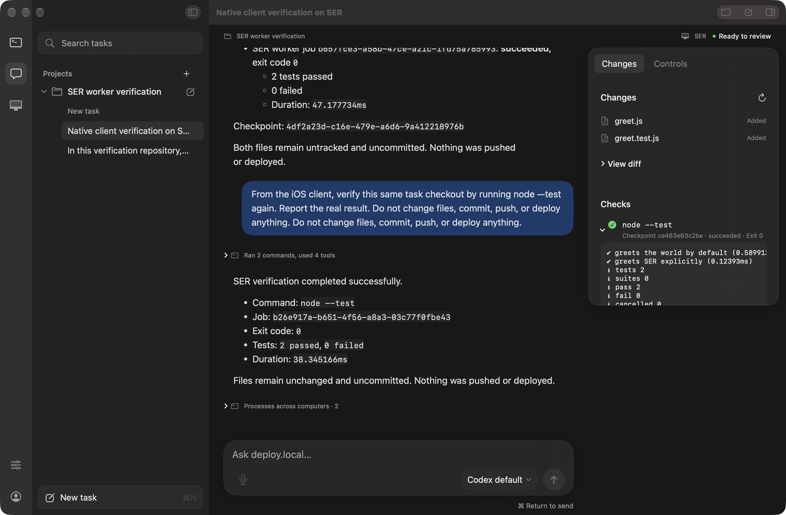
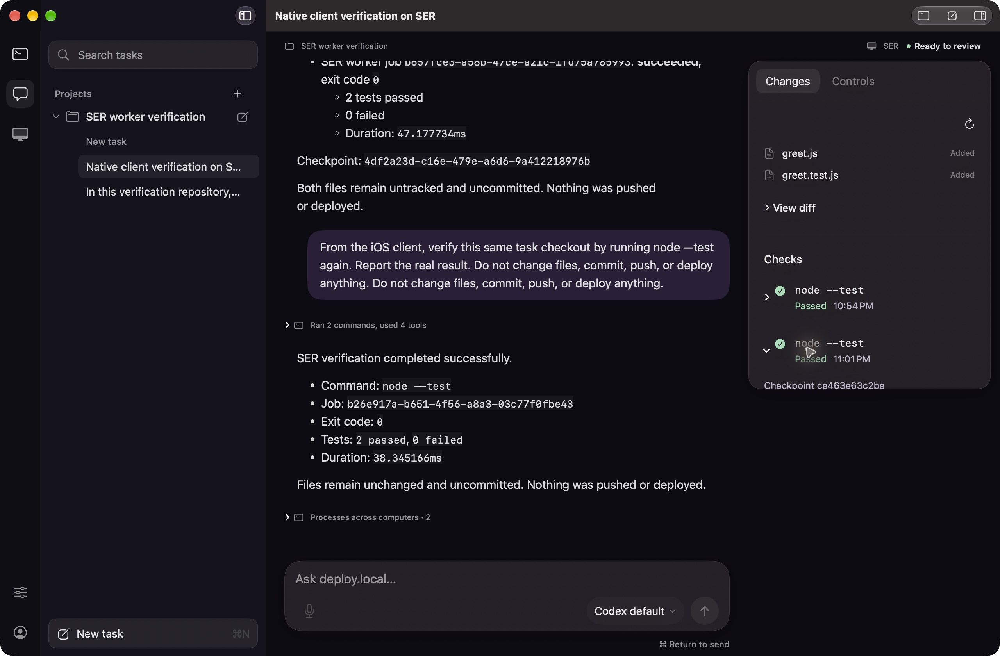
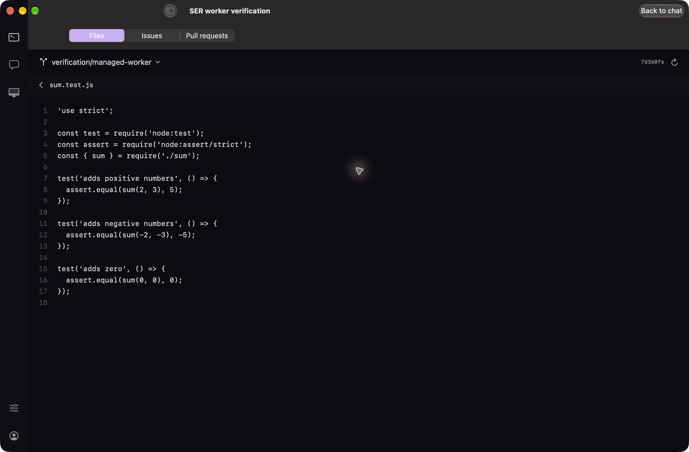
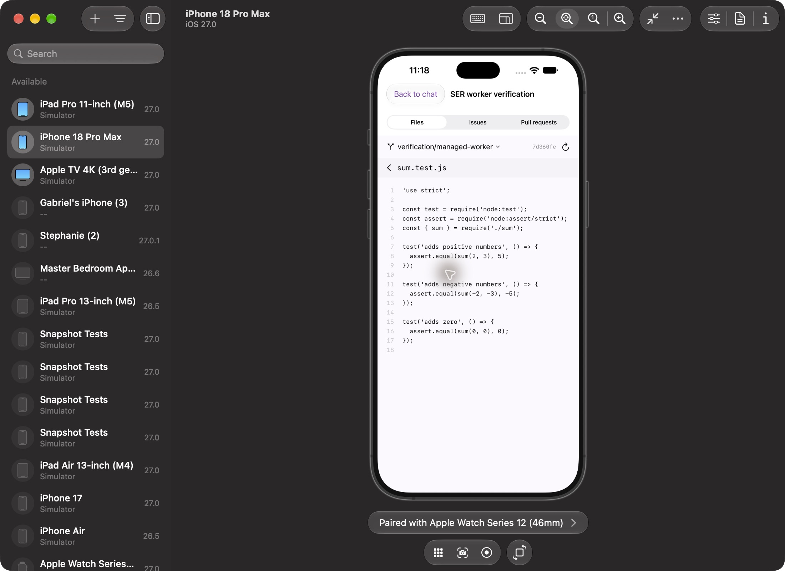
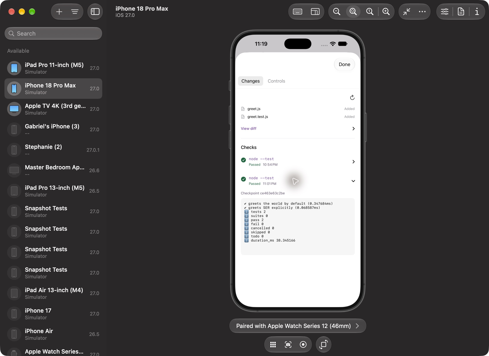

# Native polish follow-up

Verified October 16, 2026 against trusted `https://deploy.local` on macOS and an iPhone 18 Pro Max simulator running iOS 27. This follows the [authenticated native coding verification](../native-ser-ui/README.md).

## Changes

- Native surfaces, user messages, action controls and status colors now mirror the web design tokens. All 11 native color tokens were compared with `app/design-tokens.json` in both modes; see `token-parity.json`. The native palette is currently a matching Swift counterpart, not generated from JSON.
- Shared 120/180 ms motion tokens cover button presses and model/checkpoint disclosures. Reduce Motion disables these transitions and pressed scaling. Streaming and polling updates do not receive decorative animation.
- The model popover has more comfortable spacing, explicit selected state and provider availability. Custom model entry is disabled when its provider is unavailable.
- Review no longer repeats the selected Changes heading or shows remote-check guidance after results exist. Checkpoint rows have clear status, timestamps that distinguish repeated commands, unique accessibility identifiers and bounded output scrolling. Failed jobs use the semantic failure color.
- Repository browsing occupies the content pane instead of a grouped settings form. A flat branch menu, path/back controls, real commit identifier, Name/Kind columns and line-numbered source replace the previous branch-label list. No unsupported size or commit-message columns are invented.
- Branch, folder and file selection persist per project/account/window. File requests are cancelled and assigned unique generations so stale responses cannot replace newer navigation.
- Transcript reading positions are saved separately for each task. Scrolling earlier pauses following, and Jump to latest returns to live output. On macOS 15/iOS 18 and later, pixel offsets survive layout changes and destination navigation; the older supported OS versions use message anchors. Keyboard focus has a restrained dashed violet outline; arrows, Page Up/Down, Home/End and Command-Up/Down navigate without taking editing keys from the composer. Bookmark updates are atomic so changing follow state cannot overwrite the saved offset.

## UI verification

The Mac client restored a transcript scrollbar value of **0.3848167539267016** after both task switching and Computers → Back to chat navigation. It retained the same reading position after repository navigation as well. The branch menu changed from main to verification/managed-worker, loaded sum.test.js, and restored both branch and file after Files → Issues → Files.

The final keyboard check used Home → Down, producing scrollbar **0.1047120418848168**. That exact value survived task switching and Computers → Back to chat. Page Up/Down and Home/End reached the expected boundaries; arrow scrolling moved incrementally. An unsent composer draft retained editing focus and was cleared. Transcript disclosure controls remained operable. See `mac-keyboard-focus.png`.

The iOS Simulator restored its existing signed-in session after each update. It displayed the shared violet palette, opened the same task and its real passing checkpoint output, switched to verification/managed-worker, loaded line-numbered sum.test.js, and restored the branch/file after visiting Issues. No new coding run was needed for this visual pass; the earlier Mac/iOS execution results remain in the linked evidence.

Both native targets built successfully and passed strict signature verification. All **13 Swift tests** passed. An independent macOS build of just the staged native source also passed. The installed Mac and simulator builds include the user's pre-existing native working-tree changes; those changes remain preserved and unstaged. No server change or restart is required by this native-only commit.

## Before and after

Before:

After:

The reading-position screenshots capture the earlier task-switch verification; `verification.json` records the final task/destination checks.

## Limits

Physical-device and older-OS walkthroughs were not performed. Reduced-motion behavior was checked in source, not by changing the user's system accessibility preference. This pass covers the named native flows; it does not claim an exhaustive audit of every native destination or live web route.
