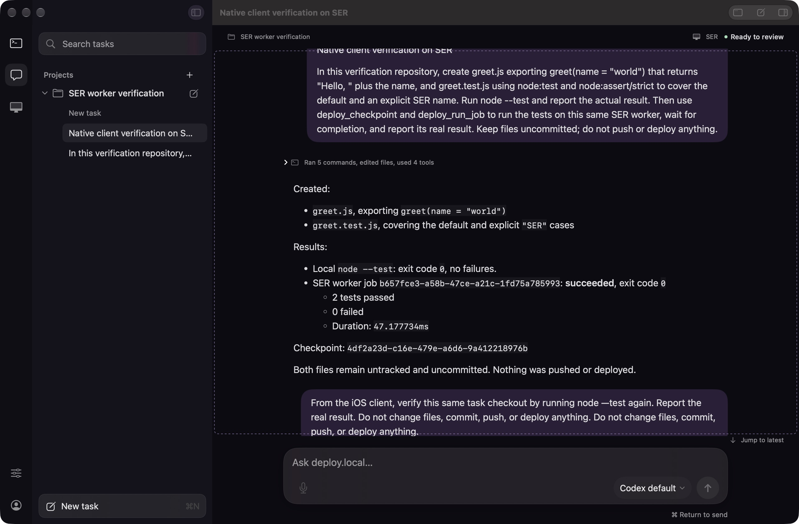
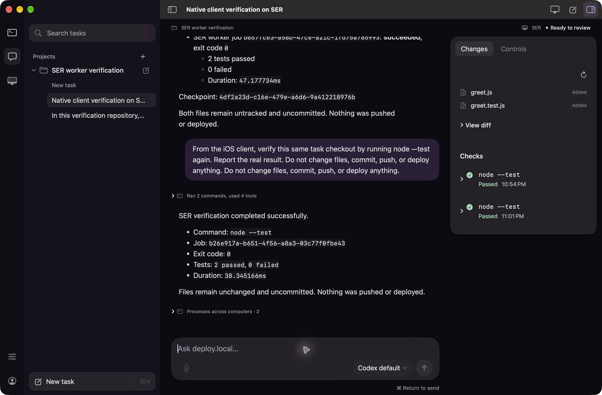
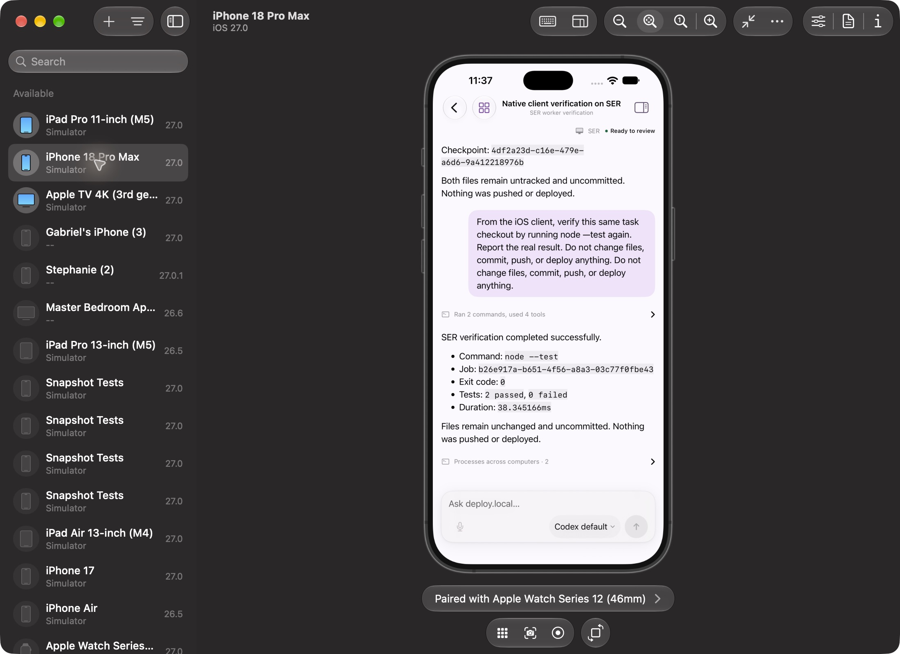

# Native toolbar refinement

The toolbar now uses shared `WorkspaceToolbarIcon`, `WorkspaceToolbarButtonStyle` and `WorkspaceStyle.Toolbar` tokens in `native/Apple/Packages/DeployKit/Sources/DeployUI/WorkspaceToolbar.swift`.

- Regular, monochrome SF Symbols at 16 pt on Mac and 18 pt on iOS.
- Equal 32 pt Mac / 44 pt iOS hit targets; Mac actions have 6 pt gaps.
- Quiet neutral icons, violet selected panel states, and restrained hover/pressed feedback using the existing 120 ms motion token. Reduce Motion removes scaling and transitions.
- macOS/iOS 26+ shared glass backgrounds are hidden for these task actions. Earlier supported OS versions retain the platform toolbar container.
- A single Mac sidebar toggle replaces the automatic toggle, with Command-Control-S. It is removed at the sidebar scope to prevent duplicate controls. iOS keeps its standard back/navigation controls.
- Computer use toggles open/closed, New task retains Command-N, and Changes and tools retains Command-Shift-I. Toggle accessibility values announce Shown/Hidden.
- iOS review uses the same sidebar-right symbol and shared target/style.

## Verified

Installed Mac and iPhone 18 Pro Max Simulator builds against `https://deploy.local`. Verified sidebar collapse by click and restore by shortcut, inspector click/shortcut with selected state, computer viewer open/close, New task with disabled task-specific actions, and return to the existing task without creating a task. The iOS review icon opened the review sheet. Both targets and an independent macOS build of just the staged source passed; signatures verified. Existing unrelated working-tree edits remain unstaged and are present in the installed app as in the previous native pass.

Initial Mac app showed a cached connectivity error; relaunch restored the live connection. The endpoint returned HTTP 200. No service change or restart was made. This change is visual/interaction-only; no new coding job or physical-device/older-OS walkthrough was performed.

## Before / after

