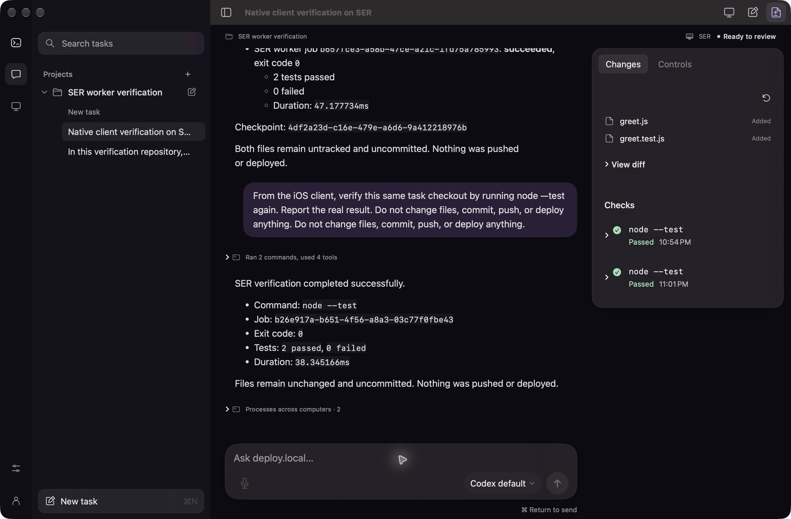
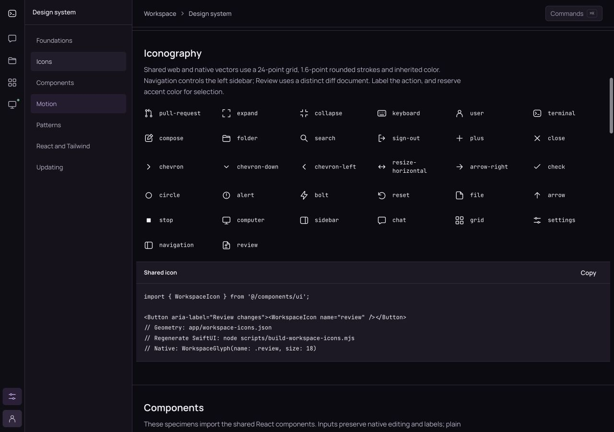
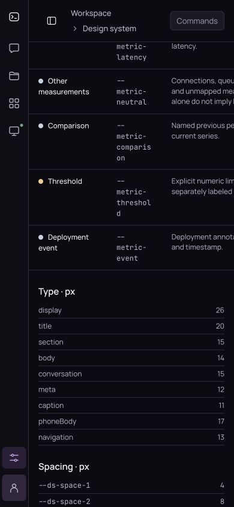
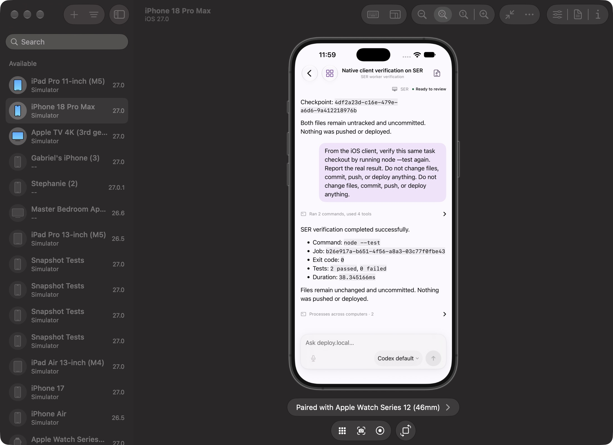

# Shared custom iconography

The web workspace's 30 custom glyphs now live in `app/workspace-icons.json`, with new `navigation` and `review` glyphs that distinguish the left sidebar from review tools. React renders the manifest through the shared `WorkspaceIcon` export. `scripts/build-workspace-icons.mjs` generates SwiftUI paths from the same geometry, including rounded shapes and endpoint arcs. Native icons use inherited semantic foreground color and scalable vector drawing; no raster assets or runtime SVG parser are required.

Native task toolbar, activity rail, common search/folder/compose symbols, file rows and repository controls use these vectors. Toolbar glyph frames are 20 pt on Mac and 24 pt on iOS to account for the 24-point grid's internal breathing room, inside existing 32/44 pt targets. Platform navigation/disclosure and platform-specific status symbols retain native rendering. Action labels and identifiers belong to their enclosing buttons.

The running app exposes all 32 glyphs, the shared grid/stroke contract and copyable React/SwiftUI usage at [Design system → Icons](https://deploy.local/dashboard/design-system#design-icons). Future geometry changes go in the manifest, followed by `pnpm icons:build` and `pnpm icons:check`.

## Verification

- Web typecheck and production build passed locally and on SER. SER release preparation passed 566 tests, failed 0, skipped 14.
- Web release `834be06` activated on SER without sudo; service healthy. It includes source `678c551` plus the Icons navigation link. Later source `b1323c8` changes only native optical sizes.
- Live desktop reference (1280 × 900) displayed 32 nonempty SVGs, each using `0 0 24 24` and stroke 1.6. The compact grid (390 × 844) had matching client/scroll widths of 310 px, with no horizontal overflow. Enter on the Icons drawer link closed navigation; keyboard focus moved into the copyable code region. Temporary viewport overrides were reset.
- Mac/iOS Simulator builds and strict signature checks passed; latest builds installed and connected to the deployed service. Mac toolbar actions expose distinct accessible names/identifiers. The custom Review button opened the inspector and announced Shown. The iOS custom Review icon opened the review sheet.
- An independent Mac build of the committed native source plus optical-size adjustment passed. Installed native apps also include the preserved pre-existing native working-tree changes, which remain outside this commit.
- No new coding job, physical-device test, older-OS walkthrough or exhaustive native screen audit was performed for this icon pass.

Before: [previous SF Symbol toolbar](../native-toolbar/mac-after.png).

After:

